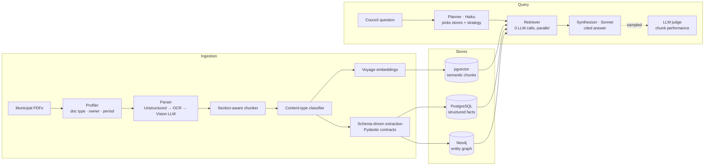
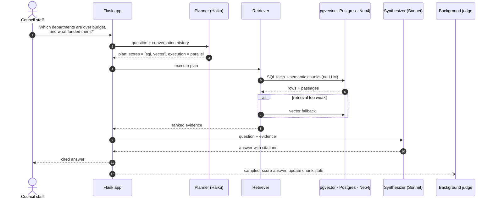

# Council Knowledge Base

**An AI decision-support system for city councils and clerks.** Council staff ask a plain-English question, such as *"Which departments are over budget this year, and which resolutions funded them?"*, and get a cited answer drawn from hundreds of municipal PDFs: budgets, quarterly reports, resolutions, legislation and meeting minutes.

The pilot data set is the **City of Harrisburg, PA**. The system was built alongside the city clerk's office, and its feature priorities come from working sessions with them.

> **What makes it different:** most document-chat tools look up one document at a time. This one combines facts from different sources. It pulls a budget line from a quarterly report, the resolution that approved it, and the department that owns it, then merges them into one answer with citations.

---

## Highlights

- **Retrieval across three stores.** Each question is routed to semantic search (pgvector), structured SQL facts (PostgreSQL), or an entity graph (Neo4j), in whatever combination it needs. The results are then combined into one cited answer.
- **Two LLM calls per question.** A cheap model (Claude Haiku) plans the retrieval, and a stronger model (Claude Sonnet) writes the answer. Retrieval itself uses no LLM calls, which keeps latency and cost predictable.
- **An ingestion pipeline that handles messy real-world PDFs.** Parsing gets heavier only when it needs to: Unstructured, then Tesseract OCR, then a vision LLM. Each step is triggered by measured text quality (garble ratio, readability, characters per page).
- **Content-type routing.** Every chunk is classified (narrative, table, metrics, org data, project, header) and sent to the stores that can use it. Every chunk goes to vector search, and structured facts also land in typed SQL tables.
- **Schema-driven extraction.** Each document type (budget, quarterly report, resolution, minutes, legislation, grants, goals) has its own Pydantic extraction schema, which acts as the contract for what the LLM must return.
- **Document types are discovered, not hand-written.** An LLM profiler classifies unknown documents. Low-confidence ones are kept out of the structured stores (vector search only), and new document types go through a **human approval step** before any new table is created.
- **Built-in evaluation and cost tracking.** A sample of answers is scored in the background by an LLM judge, and those scores feed per-chunk performance stats. A 50-question golden set measures accuracy over time, and every LLM call is logged with its token cost (`/admin/costs`).
- **A dashboard council staff can use.** It shows year-to-date budget tracking, grant status, goal progress, resolution and legislation tracking, and auto-generated review questions for each department ahead of the next quarter.
- **450+ automated tests**, with live-database tests kept separate so CI runs without a database.

---

## Architecture



### How a question is answered




1. **Plan.** Claude Haiku reads the question (plus the conversation so far, for follow-ups) and decides which stores to query and whether to query them in parallel or in sequence.
2. **Retrieve.** The planned stores are queried with no LLM calls. If retrieval comes back weak, a vector-search fallback runs automatically.
3. **Synthesize.** Claude Sonnet writes the answer, with a citation for every claim pointing back to the source document.
4. **Evaluate.** For a configurable share of questions, a background LLM judge scores the answer and updates per-chunk quality stats. This runs separately from the request, so a judge failure can never break an answer.

### How a document is ingested

Each PDF goes through **profile → parse → chunk → tag → classify → embed → route**. Batches run on a bounded thread pool, and if one document fails, the rest of the batch still completes. Validation guardrails reject malformed extractions before they reach the database. Ingesting is idempotent, so a document that is already ingested is skipped unless you ask for a re-ingest.

---

## Tech stack

| Layer | Technology |
|---|---|
| Language | Python 3 |
| Web app | Flask, server-rendered HTML dashboard |
| LLMs | Anthropic Claude (Haiku 4.5 for routing and classification, Sonnet 4.6 for vision and synthesis) |
| Embeddings | Voyage AI `voyage-3` (1024-dim) |
| Vector search | PostgreSQL + pgvector |
| Structured data | PostgreSQL (Supabase), hand-written SQL migrations |
| Graph | Neo4j (optional; graph features turn off cleanly if it's unavailable) |
| PDF parsing | Unstructured, pdfplumber, Tesseract OCR, Claude vision |
| Validation | Pydantic v2, pydantic-settings |
| Reliability | tenacity (retries), structlog |
| Testing | pytest (unit and integration markers) |
| Deployment | Vercel serverless |

---

## Engineering decisions

- **Model choices were tested, not assumed.** Haiku replaced Sonnet for query classification and document profiling only after it passed an evaluation against the golden set. Model names live in `config.py`, not in the code, so they can be swapped and re-evaluated.
- **Keep the LLM away from facts the database already has.** Numbers such as dollar amounts, vacancy counts and vote tallies come from typed SQL rows. The LLM writes the answer but doesn't make up the figures.
- **Humans approve schema changes.** The system can *propose* a new document type and table, but it never changes the database schema on its own. Low-confidence documents stay searchable but stay out of the structured tables.
- **Optional stores fail softly.** If Neo4j is down, graph features are lost but answers still work.
- **Cost is tracked from the start.** Every Anthropic call goes through a wrapper that records input, output and cache tokens, and the estimated dollar cost, to an `llm_usage` table.
- **Serverless-aware dependencies.** Heavy OCR and parsing libraries are only needed for ingestion (`requirements-ingest.txt`), so the deployed web app stays small enough for Vercel.

---

## Project structure

```
app.py                  Flask app: Q&A, dashboard, upload/ingest, admin routes
src/
  config.py             Typed settings (models, thresholds, workers)
  models.py             Core data models + content-type → store routing table
  ingestion/            Profiler, parsers, chunker, classifier, registry, triage, validation
    parsers/            Unstructured / Tesseract / Vision LLM parsers
    schemas/            Pydantic extraction schemas per document type
  extraction/           SQL + graph fact extraction, goal trackability
  query/                Planner, retriever, synthesizer, clarity gate
  storage/              VectorStore (pgvector), SQLStore, GraphStore (Neo4j)
  dashboard/            YTD rollups, projects, review-question generation
  evaluation/           Golden-set suite, sampled LLM judge, ingestion judge
  llm/                  Cost-tracking Anthropic client
sql/                    Base schema + dated migrations
scripts/                Ingest, re-extract, backfill and evaluation CLIs
templates/              Dashboard UI
tests/                  450+ tests mirroring src/
docs/design/            Original spec, per-feature design specs and implementation plans
```

---

## Running locally

**Prerequisites:** Python 3.11+, PostgreSQL with the `pgvector` extension, and API keys for Anthropic and Voyage. Neo4j is optional.

```bash
# 1. Install
pip install -r requirements.txt -r requirements-dev.txt
pip install -r requirements-ingest.txt   # only needed to ingest PDFs

# 2. Configure
cp .env.example .env                      # add API keys + DATABASE_URL

# 3. Create the schema
psql "$DATABASE_URL" -f sql/schema.sql
for f in sql/migrate_*.sql; do psql "$DATABASE_URL" -f "$f"; done

# 4. Ingest documents (place PDFs in docs/)
python scripts/ingest.py                  # or --file X.pdf, --reingest

# 5. Run the app
./run.sh                                  # http://localhost:5001
```

### Tests

```bash
pytest                    # unit tests (no database required)
pytest -m integration     # tests that need a live PostgreSQL
```

---

## Status and roadmap

The project is in active use with the Harrisburg pilot. Recent work, driven by feedback from the clerk's office:

- Year-to-date budget reporting by department
- Tracking each piece of legislation and each resolution through its lifecycle
- Deduplicating grants, with one consistent count of active grants
- Scoring how trackable each council goal is
- Detail pages for resolutions and projects

**Next:** onboarding additional cities, adding boards and commissions as a new document type, and production hardening (role-based auth, per-user cost caps, read-only query execution).

---

## Author

Built by **Leena Dudi**. [GitHub](https://github.com/leenadudi)
